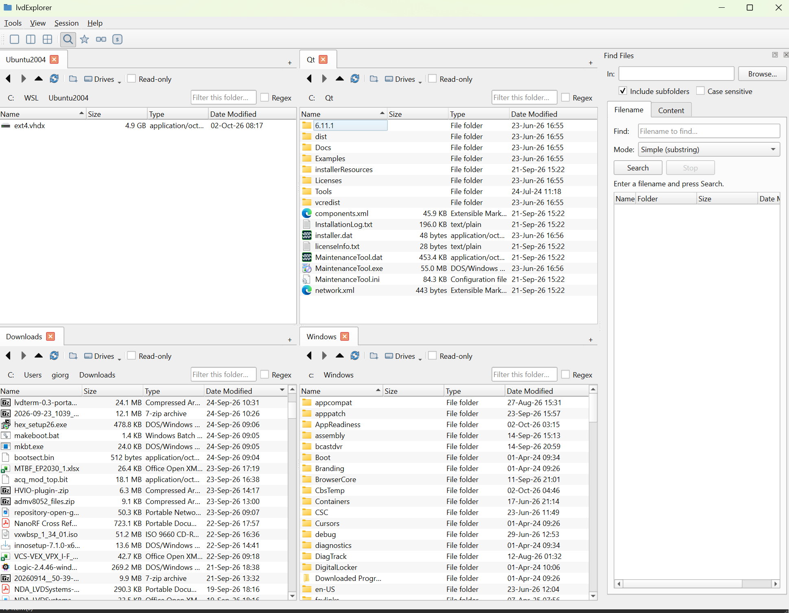
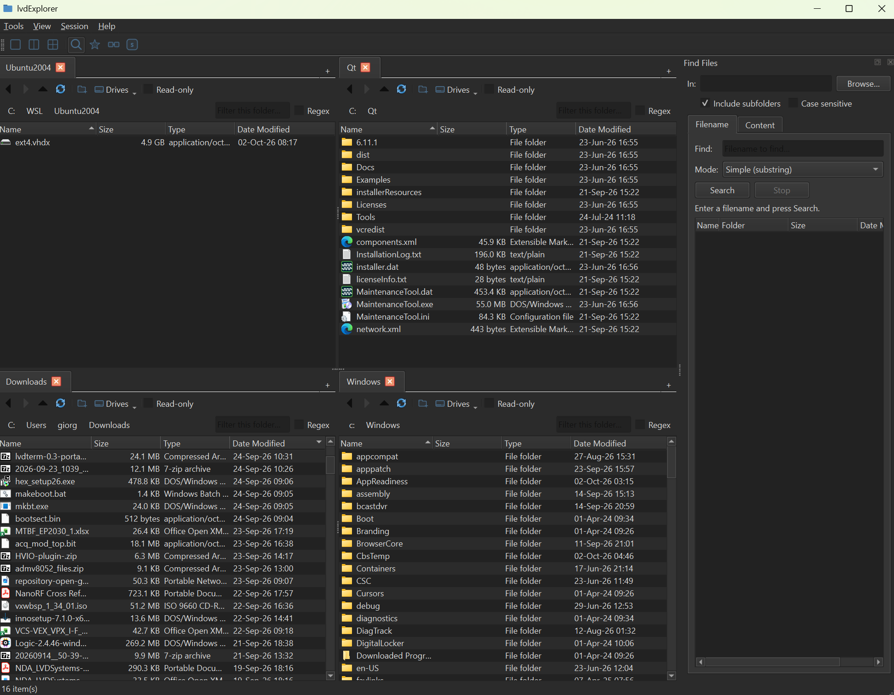
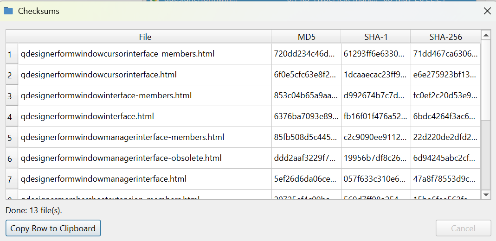

<p align="center">
  
</p>

<h1 align="center">lvdExplorer</h1>

<p align="center">
  An open-source, Qt6-based multi-pane file manager for Windows and Linux, with powerfull integrated search, grep and file hashing.
</p>

<p align="center">
  <a href="https://www.lvdopen.eu">www.lvdopen.eu</a> ·
  <a href="https://www.lvdsystems.eu">www.lvdsystems.eu</a>
</p>

<p align="center">
  <a href="https://github.com/lvdsystems/lvdExplorer/releases/latest"><strong>Download the latest release</strong></a>
</p>




## Features

- **Multi-pane, multi-tab browsing** — 1, 2 (Commander-style side-by-side,
  or stacked), or 4 panes, each with its own tab bar; quick-switch icons
  and `Ctrl+1`/`2`/`3`/`4`.
- **Built to outpace Explorer and native desktop file managers on the
  cases that make them stutter** — directory scans, the instant filter,
  and search all run off the UI thread and stream results in as they're
  found, so a slow network share or a 100k+-file folder never blocks the
  window the way Explorer's own listing (or GNOME/KDE's file managers)
  can. See [PERFORMANCE.md](PERFORMANCE.md) for the replicable benchmark
  suite and measured numbers.
- **Session save/restore** — window layout, every pane's tabs, sort
  order, and columns come back on next launch; named sessions via
  **Session → Sessions...**.
- **Instant filter + threaded Finder** — per-pane substring/regex filter,
  plus a dockable recursive file finder (`Ctrl+F`) that streams results
  as it searches.
- **Real drag & drop** — between panes/tabs and to/from Explorer/Nautilus,
  routed through a cancelable progress queue with a live dialog.
- **Native shell integration (Windows)** — the real `IContextMenu` shell
  menu, Open Terminal Here, native Properties (incl. combined multi-select
  properties), all reachable from the app's own context menu.
- **File ops** — batch rename (pattern or find/replace), MD5/SHA-1/SHA-256
  checksums, folder compare, new folder, all via the same cancelable job
  queue as copy/move/delete.
- **Custom Actions** — define your own "New File" templates and
  per-extension "Open With" entries (e.g. `.zip`/`.7z` with an external
  7-Zip) from **Tools → Custom Actions...**; off by one toggle if you
  don't want the extra context-menu entries.
- **Per-pane read-only lock** — a checkbox that blocks delete/rename/move
  in that pane without a separate "are you sure" for every click.
- **Light/dark theming** and a **keyboard shortcut editor** — every
  shortcut in the app is rebindable, with conflict detection.
- **Ships two ways** — a portable `.zip`/Inno Setup installer on Windows,
  an AppImage on Linux.
- **GPLv3, no telemetry, no accounts.**



## Building

Requires Qt 6.5+ (developed against 6.11.1) and CMake 3.23+.

### Windows (MSVC)

Run from a "x64 Native Tools Command Prompt for VS 2022" (or after calling
`vcvarsall.bat x64`) so `cl.exe` is on `PATH`:

```
cmake --preset windows-msvc
cmake --build --preset windows-msvc
```

The `windows-msvc` preset points `CMAKE_PREFIX_PATH` at
`C:/Qt/6.11.1/msvc2022_64` — edit `CMakePresets.json` (or create a
`CMakeUserPresets.json`, already git-ignored) if your Qt install lives
elsewhere.

### Linux

```
cmake --preset linux
cmake --build --preset linux
```

Requires a system Qt6 (`qt6-base-dev` or equivalent) with `Widgets` on the
CMake package search path. On Debian/Ubuntu:

```
sudo apt-get install cmake ninja-build qt6-base-dev qt6-svg-dev \
    qt6-l10n-tools qt6-tools-dev qt6-tools-dev-tools pkg-config
```

## Testing

```
ctest --test-dir build --output-on-failure
```

Covers the async search engine, the copy/move/delete job queue (including
the read-only-lock rejection paths), folder comparison, and the keyboard
shortcut registry.

## Performance

```
cmake --build build --target perftest --config Release
build/Release/perftest.exe
```

A replicable `QBENCHMARK`-based suite (`tests/perftest.cpp`) covering pane
load, instant filter, filename search, selection, navigation, and
refresh-while-selected timings, modeled on the category breakdown
[RoyiFileManager](https://github.com/RoyiAvital/RoyiFileManager) publishes
for its own releases. It's a timing report rather than a pass/fail check,
so it isn't part of `ctest` — build and run it directly, always against a
**Release** build. See [PERFORMANCE.md](PERFORMANCE.md) for methodology
and results.

## Packaging (Linux)

```
bash packaging/linux/build-appimage.sh
```

Builds Release, downloads `linuxdeploy`/`linuxdeploy-plugin-qt` on first
run (cached under `packaging/linux/tools/`, not vendored), and writes
`lvdExplorer-<version>-x86_64.AppImage` to `dist/`. Needs `curl`,
`pkg-config`, and `file` on `PATH` in addition to the build dependencies
above.

An AppImage is only as portable as the oldest glibc/libstdc++ it was
*linked* against, so the release published on the newest build machine
available (glibc 2.39+) won't run on something like Ubuntu 20.04/22.04.
A second, older-baseline AppImage is built for that:

```
bash packaging/linux/build-appimage-legacy-docker.sh
```

This needs only Docker — it builds inside an actual `ubuntu:20.04`
container (installing CMake, Qt 6.5.3 via
[aqtinstall](https://github.com/miurahr/aqtinstall), and the rest of the
build deps inside it on first run; cached under
`~/.cache/lvdexplorer-docker-qt` after that) and writes
`lvdExplorer-<version>-x86_64-glibc2.31.AppImage` to `dist/` — named
after the actual glibc version linked against (detected at build time,
not hardcoded) rather than the distro, since glibc compatibility is what
actually determines where it runs and that naming doesn't imply a false
promise about any other distro or version. Covers roughly Ubuntu
20.04+/Debian 11+/Fedora 31+ and similar. The plain
`lvdExplorer-<version>-x86_64.AppImage` covers the newest distros but
needs glibc 2.39+.

It has to be a genuine Ubuntu 20.04 build environment, not just a
pointer at an older Qt — this one took a real-world failure to learn.
`packaging/linux/build-appimage.sh`'s `QT_PREFIX_PATH`/`OUTPUT_SUFFIX`
env vars look like they'd do the same thing by pointing the build at a
downloaded Qt 6.5.3 while still compiling on whatever host is running
the script, and a 0.4.0 release built exactly that way (on a Debian 13
host) did pass local testing. It then failed on a real Ubuntu 22.04
machine with `GLIBC_2.38`/`GLIBC_2.39` "version not found" errors —
*newer* requirements than Ubuntu 22.04 itself ships, let alone 20.04.
linuxdeploy's Qt plugin only bundles Qt's own libraries; everything an
AppImage normally expects the host to already have (libc, libstdc++,
libsystemd, libicu, libglib, ...) still gets linked from whatever's
actually installed on the machine doing the compiling. Building inside
an actual `ubuntu:20.04` container is what makes those link against
Ubuntu 20.04's own versions instead. Confirmed fixed by checking the
rebuilt binary's highest required symbol versions
(`objdump -T dist-extracted/usr/bin/lvdExplorer | grep -oE 'GLIBC_[0-9.]+' | sort -V`
dropped from 2.39 to 2.14) and by running the result on that same real
Ubuntu 22.04 machine.

### .deb

```
bash packaging/linux/build-deb.sh
```

Writes `lvdexplorer_<version>_<arch>.deb` to `dist/`, hand-rolled with
`dpkg-deb` rather than CPack. Unlike the AppImage, this is a *thin*
package — it depends on the build machine's own Qt6 and libarchive via
`apt` (detected from the actual linked binary with `ldd` + `dpkg -S`,
not hardcoded package names, since those have changed across Debian/
Ubuntu releases) rather than bundling them, which is the normal shape for
a `.deb` and keeps it small. That also means a `.deb` built here only
targets the distro release it was built on (or a close match) — there's
no `OUTPUT_SUFFIX`/`QT_PREFIX_PATH` legacy-baseline option the way the
AppImage has one, since "works on an older glibc" isn't something a thin
package can promise. Needs `dpkg-deb` in addition to the AppImage's build
dependencies (already present on Debian/Ubuntu by default).

## Packaging (Windows)

Scripts under `packaging/windows/` produce distributable builds; both
build Release from scratch, so no separate build step is needed first.

```
# Self-contained .zip with Qt DLLs bundled (windeployqt) and the
# lvdExplorer.ini marker that switches the app into portable mode:
powershell -File packaging\windows\make-portable-zip.ps1

# Inno Setup installer (requires Inno Setup 7's ISCC.exe):
powershell -File packaging\windows\build-installer.ps1
```

Both write to `dist/`. Pass `-QtBinDir <path>` if your Qt install isn't at
`C:\Qt\6.11.1\msvc2022_64\bin`, and `build-installer.ps1` also takes
`-IsccPath <path>` if Inno Setup isn't at its default location.

## Contributing

See [CONTRIBUTING.md](CONTRIBUTING.md). Participation is covered by the
[Code of Conduct](CODE_OF_CONDUCT.md).

## License

GPLv3 — see [LICENSE](LICENSE).
